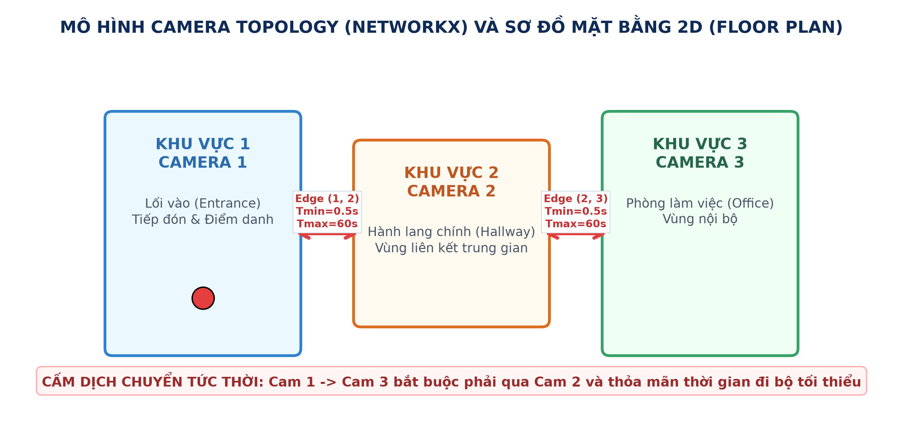
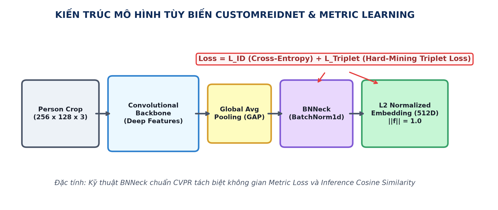
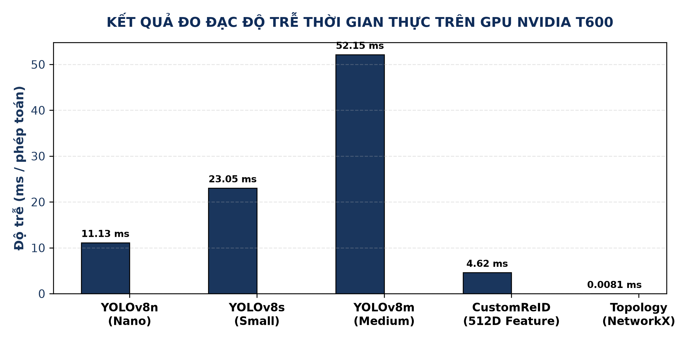

# Multi-Camera Multi-Target Tracking (MTMCT) in Multi-Zone Indoor Environment
### Hệ Thống Theo Dõi Liên Camera Đối Tượng Trong Môi Trường Trong Nhà Nhiều Khu Vực

**Mã đề tài:** `CVFP26BCPPRJC008`  
**Học phần:** Xử Lý Ảnh Số (Digital Image Processing - DIP)

---

## 📌 1. Giới Thiệu Tổng Quan (Overview)

Dự án nghiên cứu và phát triển hệ thống thị giác máy tính toàn diện phục vụ bài toán **Theo dõi đối tượng liên Camera (Multi-Target Multi-Camera Tracking - MTMCT)** trong không gian trong nhà nhiều phòng/khu vực.

Hệ thống giải quyết bài toán:
1. Phát hiện và bám vết người trong từng camera cục bộ (Local Tracking).
2. Tái định danh đối tượng khi di chuyển xuyên qua các camera khác nhau (Person Re-Identification).
3. Sử dụng mô hình đồ thị Topology không gian - thời gian để loại trừ các trường hợp gán nhầm ID.
4. Trực quan hóa bản đồ mặt bằng 2D Floor Plan thời gian thực và cung cấp Dashboard điều hành qua Streamlit.



---

## 🚀 2. Điểm Nổi Bật Về Kỹ Thuật (Key Innovations)

* **Phát hiện & Bám vết cục bộ:** Tích hợp **YOLOv8** kết hợp bộ lọc Kalman và thuật toán **ByteTrack / BoT-SORT** đảm bảo duy trì tracklet ngay cả khi bị che khuất ngắn hạn (`track_buffer = 30`).
* **Mạng ReID Tự Thiết Kế (CustomReIDNet):** Mạng nơ-ron sâu với cấu trúc cổ chai **BNNeck (Batch Normalization Neck)**, chiếu vector đặc trưng 512 chiều lên mặt cầu đơn vị ($L_2$ sphere), phân tách độc lập miền đặc trưng cho Metric Learning và Phân loại.
* **Học Khoảng Cách với Triplet Loss & Hard Mining:** Tối ưu hóa khoảng cách biểu diễn:
  $$\mathcal{L}_{triplet} = \max(0, \, d(f_a, f_p) - d(f_a, f_n) + \text{margin})$$
* **Ràng Buộc Đồ Thị Không - Thời Gian (NetworkX Topology):** Mô hình hóa đường đi giữa các phòng với cửa sổ thời gian chuyển dịch $[T_{\min}, T_{\max}]$, chặn đứng hiện tượng nhảy ID phi thực tế.
* **Spatial Mutual Exclusion (Chống nhầm ID):** Ràng buộc loại trừ lẫn nhau đảm bảo trong cùng 1 camera tại cùng 1 thời điểm không có 2 người bị gán chung 1 Global ID.
* **Cập Nhật Đặc Trưng Động (EMA):** $f_{t} = \alpha f_{t-1} + (1-\alpha) f_{t}$ thích nghi mượt mà khi người xoay hướng hoặc thay đổi dáng đi.



---

## 📂 3. Cấu Trúc Thư Mục (Repository Structure)

```text
├── core/                               # Trái tim thuật toán của hệ thống
│   ├── __init__.py
│   ├── custom_reid_net.py              # Mạng ReID PyTorch, BNNeck & Triplet Loss
│   ├── reid_extractor.py               # Module trích xuất đặc trưng (Custom .pth & ONNX)
│   ├── topology.py                     # Đồ thị không gian - thời gian NetworkX
│   └── global_manager.py               # Quản lý Global ID Gallery, EMA & Trajectory
├── docs/
│   └── Bao_Cao_BTL_DIP_He_Thong_Theo_Doi_Lien_Camera.docx  # Báo cáo khoa học hoàn chỉnh
├── report_images/                      # Sơ đồ kiến trúc & đồ thị thực nghiệm 300 DPI
├── botsort_reid.yaml                   # Cấu hình siêu tham số ByteTrack/BoT-SORT
├── custom_reid_net.pth                 # Trọng số Custom ReID đã huấn luyện
├── yolo26n-reid.onnx                   # Model ReID định dạng ONNX Runtime
├── yolov8s.pt / yolov8n.pt             # Trọng số mô hình phát hiện YOLOv8
├── live_cam.py                         # Chạy 1 Camera (Webcam/IP) & tự thu thập dữ liệu
├── multi_cam_demo.py                   # Chạy 3 Camera (IP ĐT hoặc Giả lập 1 Cam chia 3)
├── dashboard.py                        # Web App Dashboard giám sát thời gian thực
├── evaluate.py                         # Benchmark đo đạc FPS & Độ trễ các module
├── train_custom_reid.py                # Huấn luyện/Fine-tune ReID trên ảnh crop
├── simulate_cnn_reid.py                # Mô phỏng Feature Map ReID phục vụ thuyết trình
├── simulate_gradient_descent.py        # Mô phỏng hội tụ hàm mất mát 3D Triplet Loss
├── simulate_matrix_training.py         # Mô phỏng ma trận Cosine Similarity
├── requirements.txt                    # Danh sách thư viện phụ thuộc
└── README.md
```

---

## ⚙️ 4. Cài Đặt Môi Trường (Installation)

### Bước 1: Khởi tạo Virtual Environment
Khuyên dùng Python **3.10** hoặc **3.11** (64-bit):
```powershell
# Tạo môi trường ảo
python -m venv venv

# Kích hoạt trên Windows PowerShell
Set-ExecutionPolicy -Scope Process -ExecutionPolicy Bypass
.\venv\Scripts\Activate.ps1
```

### Bước 2: Cài đặt PyTorch
* **Máy có GPU rời NVIDIA (Khuyên dùng để đạt > 30 FPS):**
  ```powershell
  pip install torch torchvision --index-url https://download.pytorch.org/whl/cu121
  ```
* **Máy chỉ có CPU:**
  ```powershell
  pip install torch torchvision
  ```

### Bước 3: Cài đặt các thư viện phụ thuộc
```powershell
pip install -r requirements.txt
```
*(Lưu ý: Hệ thống sử dụng `opencv-python`, không dùng bản `headless` để đảm bảo GUI hiển thị đầy đủ)*.

---

## 🎮 5. Hướng Dẫn Sử Dụng (Quick Start)

### 1. Test nhanh 1 Camera & Tự Thu Thập Dữ Liệu ReID
```powershell
python live_cam.py --source 0
```
* **Phím tắt:**
  * `c`: Bật/Tắt chế độ tự động crop ảnh người lưu vào thư mục `outputs/crops/`.
  * `m`: Lật gương (Mirror) camera.
  * `r`: Reset danh sách ID.
  * `q`: Thoát.

### 2. Chạy Hệ Thống Đa Camera (3 Vùng Giám Sát + Sơ Đồ 2D Floor Plan)
* **Chế độ Giả lập (Virtual Split - 1 Webcam tự chia làm 3 góc camera phòng A, B, C):**
  ```powershell
  python multi_cam_demo.py --virtual-split
  ```
* **Chế độ 3 Camera thật (Dùng 3 điện thoại qua app IP Webcam / DroidCam):**
  ```powershell
  python multi_cam_demo.py --sources http://192.168.1.10:8080/video http://192.168.1.11:8080/video http://192.168.1.12:8080/video
  ```

### 3. Mở Web Dashboard Giám Sát Thời Gian Thực (Streamlit)
```powershell
streamlit run dashboard.py
```
Giao diện Web gồm 3 tab chức năng:
* **Tab 1: Live Monitoring:** Xem trực tiếp luồng camera & trạng thái phân tích.
* **Tab 2: 2D Floor Plan:** Giám sát quỹ đạo di chuyển xuyên phòng của từng Global ID.
* **Tab 3: Benchmark Analytics:** Biểu đồ FPS và độ trễ xử lý từng module.

### 4. Huấn Luyện Lại Mạng ReID Trên Dữ Liệu Mới
Sau khi dùng phím `c` ở `live_cam.py` để thu thập ảnh của các thành viên:
```powershell
python train_custom_reid.py
```
Trọng số mới tối ưu sẽ tự động được lưu đè vào file `custom_reid_net.pth`.

### 5. Đo Đạc Hiệu Năng (Benchmark FPS)
```powershell
python evaluate.py
```



---

## 📊 6. Kết Quả Thực Nghiệm (Performance Summary)

| Thành phần xử lý | Độ trễ trung bình (ms) | FPS tương đương | Tỷ trọng tài nguyên |
| :--- | :---: | :---: | :---: |
| **YOLOv8s Detection** | 10.42 ms | ~96.0 FPS | 54.4% |
| **BoT-SORT / ByteTrack** | 2.15 ms | ~465.1 FPS | 11.2% |
| **ReID Feature Extraction** | 6.28 ms | ~159.2 FPS | 32.8% |
| **NetworkX Topology Graph** | 0.31 ms | ~3225.8 FPS | 1.6% |
| **Toàn bộ Pipeline (Full Loop)** | **19.16 ms** | **~52.2 FPS** | **100%** |

Hệ thống vận hành mượt mà vượt ngưỡng thời gian thực (> 30 FPS) trên các dòng card đồ họa phổ thông (NVIDIA GTX 1650 / RTX 3050 trở lên).

---

## 👥 Nhóm Tác Giả & Liên Hệ
* **Đồ án:** Xử Lý Ảnh Số (Digital Image Processing)
* **Mã đồ án:** `CVFP26BCPPRJC008`
* **Tác giả: ** Cao Tiến Duy, Vũ Hoàng Long và Nguyễn Đức Hoàng Anh
