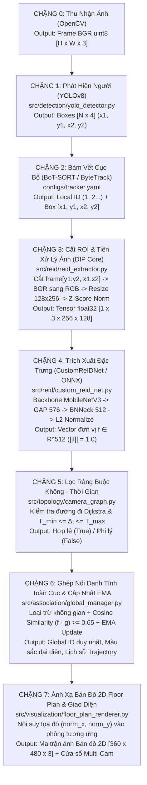

# CẨM NANG TOÀN DIỆN: LÝ THUYẾT XỬ LÝ ẢNH SỐ (DIP) & GIẢI PHẪU MÃ NGUỒN HỆ THỐNG MTMCT-VISION

**Mã đề tài:** `CVFP26BCPPRJC008`  
**Tên đề tài:** Theo dõi liên camera đối tượng trong môi trường trong nhà nhiều khu vực (*Multi-Target Multi-Camera Tracking in Multi-Zone Indoor Environment*)  
**Tài liệu đối chiếu:** Giáo trình Xử lý ảnh số – TS. Phạm Văn Sự (PTIT) & *Digital Image Processing* (Gonzalez & Woods)

---

## PHẦN I: BỨC TRANH TỔNG THỂ & DÂY CHUYỀN BIẾN ĐỔI DỮ LIỆU

### 1.1. Đồ án này thực sự "Focus" (Trọng tâm) vào cái gì?

Để không bị ngập trong hàng tá thuật ngữ AI trên mạng, bạn cần nắm vững **ranh giới giữa Công cụ phụ trợ và Đóng góp cốt lõi của đồ án**:

| Thành phần | Phân loại | Vai trò trong hệ thống | Mức độ cần đi sâu khi bảo vệ |
| :--- | :--- | :--- | :--- |
| **YOLOv8** (`yolov8s.pt`) | Công cụ có sẵn (Pre-trained) | Phát hiện người và trả về khung chữ nhật $[x_1, y_1, x_2, y_2]$. | Hiểu Input/Output và bước tiền xử lý ảnh đầu vào. Không cần train lại YOLO. |
| **ByteTrack / BoT-SORT** | Công cụ hỗ trợ | Dùng bộ lọc Kalman dự đoán vị trí và giữ ID tạm thời (`local_track_id`) trong phạm vi 1 camera. | Hiểu nguyên lý Kalman Filter + IoU Matching + `track_buffer: 30`. |
| **Mạng ReID Tùy Biến (`CustomReIDNet`)** | **TRỌNG TÂM SỐ 1 (Core Focus)** | Biến ảnh người cắt ra thành **Vector đặc trưng 512 chiều** trên mặt cầu đơn vị $L_2$. Huấn luyện bằng **Metric Learning (Triplet Loss + BNNeck)**. | **Nắm thật sâu từng dòng code**, kiến trúc mạng, công thức hàm Loss và quá trình train. |
| **Đồ thị Không - Thời Gian (`CameraTopology`)** | **TRỌNG TÂM SỐ 2 (Core Focus)** | Mô hình hóa bản đồ các phòng bằng đồ thị `NetworkX`, chặn hiện tượng "dịch chuyển tức thời" phi vật lý giữa các camera. | **Nắm thật sâu** điều kiện kiểm tra thời gian di chuyển $[T_{\min}, T_{\max}]$. |
| **Quản lý Danh tính Toàn cục (`GlobalIdentityManager`)** | **TRỌNG TÂM SỐ 3 (Core Focus)** | Phối hợp 3 chốt chặn: **Loại trừ không gian (Spatial Mutual Exclusion)** + **Topology** + **Cosine Similarity & Bộ lọc thông thấp EMA**. | **Trái tim của toàn bộ đồ án** – giải thích vì sao hệ thống không bị nhảy ID. |

---

### 1.2. Sơ đồ dây chuyền biến đổi dữ liệu qua 7 chặng (Dataflow Pipeline)

Mỗi khi camera thu được 1 khung hình (Frame), dữ liệu sẽ chảy tuần tự qua **7 chặng biến đổi** với kích thước và kiểu dữ liệu cụ thể như sau:



---

### 1.3. Bảng tổng hợp Input – Xử lý – Output của toàn bộ các file trong dự án

| File mã nguồn | Đầu vào (Input) | Quá trình xử lý bên trong | Đầu ra (Output) | Module nhận tiếp theo |
| :--- | :--- | :--- | :--- | :--- |
| [src/detection/yolo_detector.py](file:///c:/Users/Windows/Desktop/BTL%20DIP/BTL_DIP_GitHub/src/detection/yolo_detector.py) | Ma trận ảnh gốc `frame` (`np.ndarray`, shape $[H, W, 3]$, hệ màu BGR). | Co giãn ảnh về $640 \times 640$, chạy mạng CNN YOLOv8, lọc `classes=[0]` (người) và ngưỡng `conf >= 0.45`. | Đối tượng `Results` chứa các hộp bao $[x_1, y_1, x_2, y_2]$, độ tự tin `conf`, và `local_track_id`. | `src/pipeline.py` / `scripts/run_live_cam.py` |
| [configs/tracker.yaml](file:///c:/Users/Windows/Desktop/BTL%20DIP/BTL_DIP_GitHub/configs/tracker.yaml) | Danh sách hộp bao ở frame $t$ và trạng thái bộ lọc Kalman ở frame $t-1$. | Dự đoán vị trí mới bằng bộ lọc Kalman 8 chiều, giải bài toán ghép cặp Hungarian bằng khoảng cách IoU, lưu vết mất dấu tối đa 30 frames (`track_buffer: 30`). | Số thứ tự tạm thời trong từng camera (`local_track_id`). | Bước cắt ảnh ROI (`crop = frame[y1:y2, x1:x2]`) |
| [src/reid/custom_reid_net.py](file:///c:/Users/Windows/Desktop/BTL%20DIP/BTL_DIP_GitHub/src/reid/custom_reid_net.py) | Batch Tensor ảnh người kích thước $[B, 3, 256, 128]$, kiểu `float32`. | Qua Backbone MobileNetV3-Small $\to$ Feature Map $[B, 576, 8, 4]$ $\to$ Global Average Pooling $[B, 576]$ $\to$ Linear + BatchNorm1d (`BNNeck`) $\to$ Chuẩn hóa $L_2$. | • Khi Train: `(feat_norm, cls_score)`<br>• Khi Suy luận: Vector $\vec{f} \in \mathbb{R}^{512}$ có độ dài bằng $1.0$. | `src/reid/reid_extractor.py` |
| [src/reid/reid_extractor.py](file:///c:/Users/Windows/Desktop/BTL%20DIP/BTL_DIP_GitHub/src/reid/reid_extractor.py) | Ảnh cắt người `crop_bgr` (`np.ndarray`, kích thước bất kỳ $[h, w, 3]$). | Đổi màu $\text{BGR} \to \text{RGB}$ $\to$ Resize $(128, 256)$ $\to$ Chuẩn hóa Z-Score theo `mean`/`std` ImageNet $\to$ Chạy model PyTorch hoặc ONNX. | Vector đặc trưng 1 chiều `feat` (`np.ndarray`, shape `(512,)`, `dtype=float32`, $\|\vec{f}\|_2 = 1$). | `src/association/global_manager.py` |
| [src/topology/camera_graph.py](file:///c:/Users/Windows/Desktop/BTL%20DIP/BTL_DIP_GitHub/src/topology/camera_graph.py) | `prev_cam` (phòng cũ), `new_cam` (phòng mới), `time_delta_sec` ($\Delta t$). | Tìm đường đi ngắn nhất trên đồ thị `nx.Graph`, cộng tổng thời gian tối thiểu $T_{\min}$ và tối đa $T_{\max}$ dọc theo đường đi. | `True` (nếu $T_{\min} \le \Delta t \le T_{\max}$) hoặc `False` (nếu vi phạm vật lý). | `src/association/global_manager.py` |
| [src/association/global_manager.py](file:///c:/Users/Windows/Desktop/BTL%20DIP/BTL_DIP_GitHub/src/association/global_manager.py) | `cam_id`, `local_track_id`, `crop_bgr`, `box`, `current_time`. | Kiểm tra **Spatial Mutual Exclusion** $\to$ Kiểm tra **Topology** $\to$ Tính tích vô hướng **Cosine Similarity** với bộ nhớ `gallery` $\to$ Cập nhật **EMA** ($\alpha=0.80$). | Bộ 4 giá trị: `(global_id, color, is_new, best_sim)`. | `src/visualization/floor_plan_renderer.py` |
| [src/visualization/floor_plan_renderer.py](file:///c:/Users/Windows/Desktop/BTL%20DIP/BTL_DIP_GitHub/src/visualization/floor_plan_renderer.py) | Từ điển `active_positions` chứa tọa độ tương đối và màu sắc của các `global_id`. | Quy đổi vị trí người trong camera sang tọa độ 2D của từng phòng (Entrance, Hallway, Office), vẽ vòng tròn vị trí và thông tin HUD. | Ma trận ảnh bản đồ 2D `plan` (`shape=(360, 480, 3)`). | Hiển thị lên màn hình OpenCV hoặc Web Streamlit |
| [scripts/train_reid.py](file:///c:/Users/Windows/Desktop/BTL%20DIP/BTL_DIP_GitHub/scripts/train_reid.py) | Các thư mục ảnh người trong `outputs/crops/<id>/*.jpg`. | Tăng cường dữ liệu (Lật ngang, đổi sáng/tương phản) $\to$ Tính tổng $\mathcal{L}_{\text{CE}} + \mathcal{L}_{\text{Triplet}}$ $\to$ Lan truyền ngược cập nhật trọng số bằng `AdamW`. | File trọng số mạng đã huấn luyện `models/custom_reid_net.pth`. | Được nạp vào `src/reid/reid_extractor.py` |

---

## PHẦN II: ĐỐI CHIẾU LÝ THUYẾT 6 CHƯƠNG XỬ LÝ ẢNH SỐ (DIP) VÀO DỰ ÁN

Phần này giúp bạn trả lời xuất sắc câu hỏi của thầy Phạm Văn Sự hoặc hội đồng: *"Đồ án này áp dụng những kiến thức nền tảng nào của học phần Xử lý ảnh số?"*

---

### 2.1. Chương 1: Nhập môn Xử lý ảnh số (`DIP01Introduction`)
* **Kiến thức giáo trình:** Quy trình xử lý ảnh số tổng quát gồm 5 bước:
  1. Thu nhận ảnh (*Image Acquisition*)
  2. Tiền xử lý (*Preprocessing*)
  3. Phân vùng ảnh (*Segmentation / Localization*)
  4. Biểu diễn và mô tả (*Representation & Description*)
  5. Nhận dạng và nội suy (*Recognition & Interpretation*)
* **Áp dụng trong code:** Class [`MTMCTPipeline`](file:///c:/Users/Windows/Desktop/BTL%20DIP/BTL_DIP_GitHub/src/pipeline.py#L18-L108) trong file `src/pipeline.py` được thiết kế khớp 1-1 với sơ đồ kinh điển này.

---

### 2.2. Chương 2: Cơ sở về Xử lý ảnh số & Biến đổi hình học (`DIP02Fundamental`)

#### a) Biểu diễn ma trận ảnh số đa kênh & Chuyển đổi không gian màu
* **Lý thuyết:** Một bức ảnh màu số kích thước $H \times W$ được biểu diễn bởi ma trận 3 chiều $I(y, x, c)$ với $y \in [0, H-1]$, $x \in [0, W-1]$, và kênh màu $c \in \{0, 1, 2\}$. Mỗi phần tử được lượng tử hóa 8-bit (`uint8`) nhận giá trị nguyên từ $0$ đến $255$.
* **Tại sao trong code phải đổi BGR sang RGB?**
  Thư viện OpenCV lưu trữ ảnh trong bộ nhớ theo thứ tự kênh **B-G-R** (Lam - Lục - Đỏ), trong khi các bộ trọng số mạng nơ-ron sâu trên ImageNet quy ước thứ tự **R-G-B** (Đỏ - Lục - Lam). Nếu không hoán vị kênh $0 \leftrightarrow 2$, một người mặc áo **đỏ** $(R=255, G=0, B=0)$ sẽ bị mạng hiểu nhầm thành mặc áo **xanh dương**!
* **Dòng code thực thi** tại [`src/reid/reid_extractor.py`](file:///c:/Users/Windows/Desktop/BTL%20DIP/BTL_DIP_GitHub/src/reid/reid_extractor.py#L81-L82):
  ```python
  rgb = cv2.cvtColor(crop_bgr, cv2.COLOR_BGR2RGB)
  ```

#### b) Phép biến đổi hình học Tỉ lệ (Affine Scaling) & Nội suy song tuyến tính (Bilinear Interpolation)
* **Lý thuyết:** Khi người ở gần camera, hộp bao có thể lớn ($400 \times 200$ pixel); khi ở xa, hộp bao nhỏ ($120 \times 50$ pixel). Để đưa vào mạng nơ-ron có kích thước đầu vào cố định, ta thực hiện phép biến đổi hình học co giãn không đồng nhất theo 2 trục về kích thước chuẩn $(W_{\text{new}}=128, H_{\text{new}}=256)$:
  $$\begin{bmatrix} x' \\ y' \end{bmatrix} = \begin{bmatrix} s_x & 0 \\ 0 & s_y \end{bmatrix} \begin{bmatrix} x \\ y \end{bmatrix}, \quad \text{với } s_x = \frac{128}{W_{\text{crop}}}, \; s_y = \frac{256}{H_{\text{crop}}}$$
  Giá trị mức xám tại tọa độ thực $(x, y)$ được tính bằng **Nội suy song tuyến tính (Bilinear Interpolation)** từ 4 điểm ảnh lân cận gần nhất:
  $$f(x, y) \approx (1-\alpha)(1-\beta)f(x_0, y_0) + \alpha(1-\beta)f(x_1, y_0) + (1-\alpha)\beta f(x_0, y_1) + \alpha\beta f(x_1, y_1)$$
* **Dòng code thực thi** tại [`src/reid/reid_extractor.py`](file:///c:/Users/Windows/Desktop/BTL%20DIP/BTL_DIP_GitHub/src/reid/reid_extractor.py#L96):
  ```python
  resized = cv2.resize(crop_bgr, (128, 256))  # Mặc định cv2.INTER_LINEAR (Bilinear)
  ```

#### c) Phép phản xạ ngang (Horizontal Reflection / Mirroring)
* **Lý thuyết:** Biến đổi tọa độ ngang $x' = W - 1 - x$, giữ nguyên $y' = y$.
* **Ứng dụng kép trong dự án:**
  1. Trong `run_live_cam.py`: `frame = cv2.flip(frame, 1)` tạo hiệu ứng gương soi trực quan.
  2. Trong `train_reid.py`: `T.RandomHorizontalFlip(p=0.5)` nhân đôi sự đa dạng góc nhìn (giúp mô hình nhận ra cùng 1 người dù người đó đi từ trái sang phải hay từ phải sang trái).

---

### 2.3. Chương 3: Nâng cao chất lượng ảnh & Bộ lọc làm mịn (`DIP03Enhancement`)

#### a) Chuẩn hóa thống kê mức xám (Z-Score Intensity Normalization)
* **Vấn đề thực tế:** Camera 1 đặt ở cửa ra vào có nắng chiếu sáng rực (mức xám trung bình cao), Camera 2 đặt trong hành lang thiếu sáng (mức xám trung bình thấp). Nếu so sánh trực tiếp giá trị pixel, cùng một chiếc áo sẽ có giá trị số hoàn toàn khác nhau.
* **Giải pháp toán học:** Đưa ảnh từ miền $[0, 255]$ về miền $[0.0, 1.0]$, sau đó thực hiện **chuẩn hóa Z-Score (Zero-Mean, Unit-Variance)** trên từng kênh màu $c \in \{R, G, B\}$:
  $$I_{\text{norm}}(y, x, c) = \frac{\frac{I(y, x, c)}{255.0} - \mu_c}{\sigma_c}$$
  với bộ tham số thống kê chuẩn:
  $$\mu = [0.485, 0.456, 0.406], \quad \sigma = [0.229, 0.224, 0.225]$$
  Phép trừ $\mu_c$ giúp **triệt tiêu độ lệch sáng nền (DC offset)**, và phép chia $\sigma_c$ giúp **cân bằng độ tương phản (Contrast normalization)**.
* **Dòng code thực thi** tại [`src/reid/reid_extractor.py`](file:///c:/Users/Windows/Desktop/BTL%20DIP/BTL_DIP_GitHub/src/reid/reid_extractor.py#L97-L100):
  ```python
  rgb = cv2.cvtColor(resized, cv2.COLOR_BGR2RGB).astype(np.float32) / 255.0
  mean = np.array([0.485, 0.456, 0.406], dtype=np.float32)
  std = np.array([0.229, 0.224, 0.225], dtype=np.float32)
  norm = (rgb - mean) / std
  ```

#### b) Bộ lọc thông thấp số trên chuỗi thời gian (EMA - Exponential Moving Average)
* **Lý thuyết:** Khi đối tượng bước đi, ở một vài frame nhất định ảnh có thể bị nhòe chuyển động (*motion blur*) hoặc bị bóng râm che ngang. Nếu thay thế hoàn toàn vector đặc trưng cũ bằng vector mới vừa chụp, mẫu nhận dạng sẽ bị nhiễu loạn.
* **Giải pháp:** Áp dụng bộ lọc truy hồi thông thấp bậc nhất (IIR Low-Pass Filter / EMA):
  $$\vec{g}_{\text{updated}} = \alpha \cdot \vec{g}_{\text{old}} + (1 - \alpha) \cdot \vec{f}_{\text{new}}, \quad \text{sau đó chuẩn hóa } \vec{g}_t = \frac{\vec{g}_{\text{updated}}}{\|\vec{g}_{\text{updated}}\|_2}$$
  Trong đó hệ số nhớ $\alpha = 0.85$ (giữ lại 85% lịch sử ổn định, chỉ hấp thụ 15% sự thay đổi góc nhìn mới).
* **Dòng code thực thi** tại [`src/association/global_manager.py`](file:///c:/Users/Windows/Desktop/BTL%20DIP/BTL_DIP_GitHub/src/association/global_manager.py#L27-L34):
  ```python
  def update_feature(self, new_feature, alpha=0.85):
      updated = alpha * self.feature + (1.0 - alpha) * new_feature
      norm = np.linalg.norm(updated)
      if norm > 1e-8:
          self.feature = updated / norm
  ```

---

### 2.4. Chương 4 & 4B: Phân vùng ảnh & Cắt vùng quan tâm ROI (`DIP04Segmentation`)
* **Lý thuyết:** Mục tiêu của phân vùng ảnh là chia bức ảnh $I$ thành các miền con rời nhau sao cho tách biệt được **Đối tượng (Foreground)** khỏi **Nền (Background)**.
* **Áp dụng trong dự án:**
  1. Thay vì dùng phân ngưỡng mức xám cổ điển (như Otsu) vốn thất bại khi màu áo trùng màu tường, ta dùng mạng học sâu **YOLOv8** để định vị chính xác hộp bao đối tượng $[x_1, y_1, x_2, y_2]$.
  2. Thực hiện phép **cắt biên giới hạn (Boundary Clamping)** để đảm bảo tọa độ không vượt ra ngoài kích thước bức ảnh $[0, W-1] \times [0, H-1]$ và **lọc nhiễu hình thái học** (loại bỏ các hộp bao rác có kích thước quá nhỏ $< 15 \times 30$ pixel):
  ```python
  x1 = max(0, min(x1, w - 1))
  y1 = max(0, min(y1, h - 1))
  x2 = max(0, min(x2, w - 1))
  y2 = max(0, min(y2, h - 1))
  if (x2 - x1) < 15 or (y2 - y1) < 30:
      continue
  crop = frame[y1:y2, x1:x2]  # Trích xuất vùng quan tâm ROI
  ```

---

### 2.5. Chương 5: Nhận dạng ảnh (`DIP05Recognition`) — TRỌNG TÂM CỐT LÕI

#### a) Không gian đặc trưng 512 chiều & Mặt cầu đơn vị $L_2$
* **Lý thuyết:** Trong Chương 5 giáo trình của thầy Sự, mỗi mẫu đối tượng được ánh xạ thành một **Vector mẫu (Pattern Vector)** $\vec{f} = [f_1, f_2, \dots, f_{512}]^T \in \mathbb{R}^{512}$.
* Mọi vector đặc trưng đầu ra đều được chuẩn hóa độ dài Euclidean ($L_2$-norm) về bằng $1$:
  $$\vec{f}_{\text{unit}} = \frac{\vec{f}}{\|\vec{f}\|_2} = \frac{\vec{f}}{\sqrt{\sum_{k=1}^{512} f_k^2}} \implies \|\vec{f}_{\text{unit}}\|_2 = 1.0$$

#### b) Tại sao Độ tương đồng Cosine tương đương Khoảng cách Euclidean trên mặt cầu đơn vị?
Giả sử có 2 vector đặc trưng $\vec{a}, \vec{b} \in \mathbb{R}^{512}$ đã được chuẩn hóa ($\|\vec{a}\|_2 = 1, \|\vec{b}\|_2 = 1$). Bình phương khoảng cách Euclidean giữa chúng là:
$$d_{\text{Euc}}^2(\vec{a}, \vec{b}) = \|\vec{a} - \vec{b}\|_2^2 = \|\vec{a}\|_2^2 + \|\vec{b}\|_2^2 - 2(\vec{a} \cdot \vec{b}) = 1 + 1 - 2\cos(\theta) = 2\big(1 - \text{CosineSim}(\vec{a}, \vec{b})\big)$$
Như vậy:
* Khi 2 ảnh là **cùng 1 người**: góc $\theta \to 0^\circ \implies \text{CosineSim} = \vec{a} \cdot \vec{b} \to 1.0 \implies d_{\text{Euc}} \to 0$.
* Khi 2 ảnh là **2 người khác nhau**: góc $\theta$ lớn $\implies \text{CosineSim} = \vec{a} \cdot \vec{b}$ nhỏ ($< 0.65$) $\implies d_{\text{Euc}}$ lớn.
* **Lợi ích tính toán:** Thay vì phải trừ từng phần tử, bình phương rồi khai căn, ta chỉ cần dùng 1 phép nhân vô hướng `float(np.dot(f1, f2))` tốn chưa đến $0.001\text{ ms}$!

#### c) Học khoảng cách (Metric Learning) với Hard-Mining Triplet Loss
Để mạng nơ-ron biết cách tạo ra các vector $\vec{f}$ có tính chất trên, ta huấn luyện bằng hàm mất mát bộ ba (**Triplet Loss**):
* Xét mẫu gốc **Anchor ($\vec{f}_a$)** của người $i$:
  * **Hard Positive ($\vec{f}_p$):** Ảnh của *cùng người $i$* nhưng ở góc chụp khó nhất (khoảng cách $d(\vec{f}_a, \vec{f}_p)$ lớn nhất trong batch).
  * **Hard Negative ($\vec{f}_n$):** Ảnh của *người khác $j \neq i$* nhưng mặc đồ giống nhất (khoảng cách $d(\vec{f}_a, \vec{f}_n)$ nhỏ nhất trong batch).
* **Công thức hàm mất mát Triplet Loss:**
  $$\mathcal{L}_{\text{Triplet}} = \frac{1}{N} \sum_{i=1}^{N} \max\Big(0, \; \max_{p \in \mathcal{P}_i} d(\vec{f}_i, \vec{f}_p) - \min_{n \in \mathcal{N}_i} d(\vec{f}_i, \vec{f}_n) + m\Big)$$
  với biên an toàn $m = 0.3$. Hàm Loss này chỉ bằng $0$ khi khoảng cách tới người lạ lớn hơn khoảng cách tới chính mình ít nhất một đoạn bằng $m = 0.3$.

---

### 2.6. Chương 6: Nén dữ liệu & Giảm chiều (`DIP06Compression`)
* **Lý thuyết:** Một ảnh crop RGB $256 \times 128 \times 3$ chứa $98,304$ byte. Nếu lưu hàng nghìn frame của mỗi người, bộ nhớ sẽ tràn và tốc độ so khớp cực chậm.
* **Áp dụng:**
  1. Tầng `nn.AdaptiveAvgPool2d((1, 1))` (Global Average Pooling) nén toàn bộ chiều không gian $8 \times 4$ của 576 kênh đặc trưng thành 1 vector 1 chiều $576$ phần tử, sau đó chiếu xuống $512$ chiều.
  2. Tỷ lệ nén thông tin đạt gần **50 lần**, chỉ giữ lại đúng các bất biến đặc trưng ngoại hình (màu sắc chủ đạo, tỷ lệ cơ thể, cấu trúc trang phục) và loại bỏ hoàn toàn nhiễu chi tiết thừa.

---

## PHẦN III: GIẢI PHẪU CHI TIẾT TỪNG MODULE CODE (`src/` & `scripts/`)

Dưới đây là phần đi sâu vào từng file code để bạn đọc đến đâu hiểu rõ như lòng bàn tay đến đó.

---

### 3.1. Module Phát hiện: `src/detection/yolo_detector.py`

File: [src/detection/yolo_detector.py](file:///c:/Users/Windows/Desktop/BTL%20DIP/BTL_DIP_GitHub/src/detection/yolo_detector.py)

```python
class YOLODetector:
    def __init__(self, model_name="yolov8s.pt", conf=0.45, device=None):
        self.device = device or ("cuda" if torch.cuda.is_available() else "cpu")
        weights_path = resolve_yolo_weights(model_name)
        self.model = YOLO(weights_path)
        self.conf = conf

    def detect_and_track(self, frame, tracker_cfg=None):
        results = self.model.track(
            source=frame,
            persist=True,       # BẮT BUỘC: Giữ bộ nhớ Kalman Filter xuyên suốt các frame liên tiếp
            classes=[0],        # Trong tập COCO 80 lớp, class 0 chính là 'person' (bỏ qua bàn ghế, tivi...)
            conf=self.conf,     # Chỉ lấy những người có độ tự tin >= 45%
            tracker=tracker_cfg,# File cấu hình configs/tracker.yaml
            verbose=False,
            device=self.device
        )
        return results[0] if results else None
```
* **Điểm mấu chốt cần nhớ:** Tham số `persist=True` cực kỳ quan trọng. Nếu để `False`, ở mỗi frame bộ lọc Kalman sẽ bị xóa sạch và cấp lại ID từ đầu!

---

### 3.2. Cấu hình Bám vết cục bộ: `configs/tracker.yaml`

File: [configs/tracker.yaml](file:///c:/Users/Windows/Desktop/BTL%20DIP/BTL_DIP_GitHub/configs/tracker.yaml)

Các thông số quyết định độ mượt của việc bám vết trong phạm vi 1 camera:
* `tracker_type: botsort`: Sử dụng thuật toán BoT-SORT (nâng cấp từ ByteTrack với khả năng bù chuyển động camera CMC và Kalman Filter cải tiến).
* `track_high_thresh: 0.45`: Ngưỡng ưu tiên vòng 1 – các hộp bao rõ nét ($\ge 0.45$) được ghép cặp trước.
* `track_low_thresh: 0.1`: Ngưỡng cứu hộ vòng 2 (đặc sản của ByteTrack) – khi một người bị người khác đi ngang che khuất một nửa, độ tự tin YOLO tụt xuống $0.20$. Thay vì vứt bỏ, thuật toán vẫn giữ hộp bao mờ này để ghép với quỹ đạo Kalman đang có, giúp **không bị đứt gãy quỹ đạo khi che khuất**.
* `track_buffer: 30`: Bộ nhớ đệm lưu giữ đối tượng trong 30 khung hình (~1 giây) kể từ lúc khuất bóng hoàn toàn.
* `match_thresh: 0.85`: Ngưỡng khoảng cách IoU để chấp nhận ghép cặp giữa dự đoán Kalman và hộp bao thực tế.

---

### 3.3. Kiến trúc Mạng ReID & Triplet Loss: `src/reid/custom_reid_net.py`

File: [src/reid/custom_reid_net.py](file:///c:/Users/Windows/Desktop/BTL%20DIP/BTL_DIP_GitHub/src/reid/custom_reid_net.py)

#### a) Giải phẫu lớp cổ chai `MetricLearningHead` (BNNeck)
```python
class MetricLearningHead(nn.Module):
    def __init__(self, in_features, embedding_dim=512, num_classes=None):
        super().__init__()
        self.fc = nn.Linear(in_features, embedding_dim, bias=False)
        self.bn = nn.BatchNorm1d(embedding_dim)
        self.bn.bias.requires_grad_(False)  # Tắt cập nhật đạo hàm bias của BatchNorm
        
        if num_classes is not None and num_classes > 0:
            self.classifier = nn.Linear(embedding_dim, num_classes, bias=False)
        else:
            self.classifier = None

    def forward(self, x):
        feat = self.fc(x)
        feat_norm = self.bn(feat)

        if self.training and self.classifier is not None:
            cls_score = self.classifier(feat_norm)
            return feat_norm, cls_score

        return F.normalize(feat_norm, p=2, dim=1)
```
* **Câu hỏi nâng cao:** *Tại sao lại để `bias=False` và `self.bn.bias.requires_grad_(False)`?*
  * **Giải thích:** Trong không gian Cosine Similarity, các siêu phẳng phân lớp (Hyperplanes) đi qua gốc tọa độ $\vec{0}$. Nếu có hệ số tự do `bias`, tâm của các cụm vector sẽ bị dịch chuyển lệch khỏi gốc tọa độ, làm biến dạng góc $\theta$ giữa các vector khi chuẩn hóa lên mặt cầu đơn vị $L_2$. Đây là kỹ thuật cốt lõi trong bài báo nổi tiếng *"Bag of Tricks and A Strong Baseline for Deep Person Re-Identification"* (CVPR Workshop).

#### b) Giải phẫu hàm `TripletLoss.forward()`
```python
    def forward(self, inputs, targets):
        n = inputs.size(0)  # Kích thước Batch (ví dụ n = 8 ảnh)
        # 1. Tính ma trận khoảng cách Euclidean pairwise kích thước [n x n]
        # Công thức hằng đẳng thức: ||a - b||^2 = ||a||^2 + ||b||^2 - 2*(a · b)
        dist = torch.pow(inputs, 2).sum(dim=1, keepdim=True).expand(n, n)
        dist = dist + dist.t()
        dist.addmm_(inputs, inputs.t(), beta=1, alpha=-2)
        dist = dist.clamp(min=1e-12).sqrt()  # Tránh căn bậc 2 của số 0 gây lỗi đạo hàm NaN

        # 2. Mặt nạ logic: mask[i][j] = True nếu ảnh i và ảnh j cùng 1 người (cùng nhãn ID)
        mask = targets.expand(n, n).eq(targets.expand(n, n).t())
        dist_ap, dist_an = [], []
        for i in range(n):
            # Hard Positive: Cùng 1 người (mask[i] == True) nhưng khoảng cách XA NHẤT (.max())
            dist_ap.append(dist[i][mask[i]].max().unsqueeze(0))
            # Hard Negative: Khác người (mask[i] == False) nhưng khoảng cách GẦN NHẤT (.min())
            dist_an.append(dist[i][mask[i] == 0].min().unsqueeze(0))
        dist_ap = torch.cat(dist_ap)
        dist_an = torch.cat(dist_an)

        # 3. Tính MarginRankingLoss: max(0, dist_ap - dist_an + margin)
        y = torch.ones_like(dist_an)
        loss = self.ranking_loss(dist_an, dist_ap, y)
        return loss
```

---

### 3.4. Đồ thị Không - Thời Gian: `src/topology/camera_graph.py`

File: [src/topology/camera_graph.py](file:///c:/Users/Windows/Desktop/BTL%20DIP/BTL_DIP_GitHub/src/topology/camera_graph.py)

* **Cấu trúc đồ thị mặc định:**
  $$\text{Cam\_1 (Cửa vào)} \underset{[0.5\text{s}, \, 60\text{s}]}{\overset{10\text{m}}{\longleftrightarrow}} \text{Cam\_2 (Hành lang)} \underset{[0.5\text{s}, \, 60\text{s}]}{\overset{12\text{m}}{\longleftrightarrow}} \text{Cam\_3 (Văn phòng)}$$
* **Giải phẫu hàm `is_transition_valid(prev_cam, new_cam, time_delta_sec)`:**
  ```python
  path = nx.shortest_path(self.graph, source=prev_cam, target=new_cam)
  total_min_sec = 0.0
  total_max_sec = 0.0
  for i in range(len(path) - 1):
      edge_data = self.graph[path[i]][path[i + 1]]
      total_min_sec += edge_data.get("min_sec", 0.5)
      total_max_sec += edge_data.get("max_sec", 60.0)

  if time_delta_sec < total_min_sec:
      return False  # Chặn lỗi dịch chuyển tức thời (Teleport)
  if time_delta_sec > total_max_sec:
      return False  # Quá hạn thời gian di chuyển hợp lệ
  return True
  ```
* **Ví dụ thực tế:** Nếu một đối tượng vừa xuất hiện ở `Cam_1` (Cửa vào) và sang `Cam_3` (Văn phòng), đường đi ngắn nhất phải qua `Cam_2`: `["Cam_1", "Cam_2", "Cam_3"]`. Tổng thời gian tối thiểu `total_min_sec = 0.5 + 0.5 = 1.0s`. Nếu có một người mặc áo giống hệt đang đứng ở `Cam_3` tại thời điểm $\Delta t = 0.2\text{s} < 1.0\text{s}$, hàm trả về `False` $\to$ **Chặn đứng việc nhận nhầm 2 người ở 2 phòng xa nhau thành 1 người!**

---

### 3.5. Bộ Quản lý Danh tính Toàn cục: `src/association/global_manager.py`

File: [src/association/global_manager.py](file:///c:/Users/Windows/Desktop/BTL%20DIP/BTL_DIP_GitHub/src/association/global_manager.py)

Đây là module điều hành trung tâm. Hãy xem cách hàm `match_or_create()` xử lý từng người xuất hiện trong khung hình:

```python
    def match_or_create(self, cam_id, local_track_id, crop_bgr, box, current_time=None):
        key = (cam_id, local_track_id)
        
        # BƯỚC 1: Nếu local_track_id trong camera này đã được cấp Global ID từ các frame trước
        if key in self.local_to_global:
            gid = self.local_to_global[key]
            identity = self.gallery[gid]
            identity.add_trajectory_point(cam_id, box, current_time, local_track_id=local_track_id)
            
            # Cứ mỗi 15 frames, trích xuất lại đặc trưng để cập nhật nhẹ EMA (alpha=0.90)
            if identity.total_detections % 15 == 0:
                feat = self.extractor.extract_crop_feature(crop_bgr)
                if feat is not None:
                    identity.update_feature(feat, alpha=0.90)
            return gid, identity.color, False, 1.0

        # BƯỚC 2: Nếu là một track mới xuất hiện -> Trích xuất vector 512D để tìm trong Gallery
        feat = self.extractor.extract_crop_feature(crop_bgr)
        best_gid = None
        best_sim = -1.0

        if feat is not None and len(self.gallery) > 0:
            for gid, identity in self.gallery.items():
                time_delta = current_time - identity.last_seen_time
                
                # CHỐT CHẶN A - RÀNG BUỘC LOẠI TRỪ LẪN NHAU (SPATIAL MUTUAL EXCLUSION):
                # Nếu Global ID này đang hiện diện ngay trong cùng camera này (time_delta < 1.5s)
                # và thuộc về một người khác (last_local_id != local_track_id)
                # -> BỎ QUA NGAY! (Vì 1 người không thể phân thân đứng ở 2 vị trí cùng lúc)
                if identity.last_cam == cam_id and time_delta < 1.5:
                    if identity.last_local_id != local_track_id:
                        continue

                # CHỐT CHẶN B - RÀNG BUỘC ĐỒ THỊ TOPOLOGY:
                if self.topology is not None:
                    if not self.topology.is_transition_valid(identity.last_cam, cam_id, time_delta):
                        continue

                # CHỐT CHẶN C - TÍNH ĐỘ TƯƠNG ĐỒNG COSINE:
                sim = self.extractor.cosine_similarity(feat, identity.feature)
                if sim > best_sim:
                    best_sim = sim
                    best_gid = gid

        # BƯỚC 3: Ra quyết định gán vào ID cũ hay cấp mới
        if best_gid is not None and best_sim >= self.similarity_thresh:  # Ngưỡng chuẩn 0.65
            gid = best_gid
            identity = self.gallery[gid]
            identity.update_feature(feat, alpha=0.80)
            identity.add_trajectory_point(cam_id, box, current_time, local_track_id=local_track_id)
            self.local_to_global[key] = gid
            return gid, identity.color, False, best_sim
        else:
            # Không khớp với ai trong bộ nhớ -> Khởi tạo Global ID mới tinh!
            gid = self.next_global_id
            self.next_global_id += 1
            ...
```

> [!TIP]
> **Điểm ăn điểm tuyệt đối khi thuyết trình:**
> Hãy nhấn mạnh vào **Chốt chặn A (`Spatial Mutual Exclusion`)**. Trước khi có chốt chặn này, nếu trong phòng có 8 người cùng mặc đồng phục giống nhau, cả 8 người đều có độ tương đồng $> 0.65$ với `ID 1` và bị gom hết thành `ID 1`. Nhờ 3 dòng code kiểm tra `identity.last_cam == cam_id and time_delta < 1.5`, một khi `ID 1` đã gắn với người số 1 thì người số 2, 3, ..., 8 bắt buộc phải được cấp `ID 2, 3, ..., 8` riêng biệt!

---

### 3.6. Ánh xạ Tọa độ 2D Floor Plan: `src/visualization/floor_plan_renderer.py`

File: [src/visualization/floor_plan_renderer.py](file:///c:/Users/Windows/Desktop/BTL%20DIP/BTL_DIP_GitHub/src/visualization/floor_plan_renderer.py)

Làm thế nào để biến vị trí người trên khung hình camera $(W \times H)$ thành vị trí chấm tròn trên bản đồ mặt bằng 2D?
1. **Tính tọa độ chuẩn hóa tương đối** $\in [0.0, 1.0]$ trong [`src/pipeline.py`](file:///c:/Users/Windows/Desktop/BTL%20DIP/BTL_DIP_GitHub/src/pipeline.py#L99-L100):
   * Hoành độ tâm người: $\text{norm\_x} = \frac{(x_1 + x_2) / 2}{W}$
   * Tung độ điểm chạm đất (chân người): $\text{norm\_y} = \frac{y_2}{H}$
2. **Phép nội suy tuyến tính ánh xạ vào hình chữ nhật của căn phòng** $[rx_1, ry_1, rx_2, ry_2]$ trên bản đồ:
   $$px = rx_1 + 15 + \text{norm\_x} \cdot (rx_2 - rx_1 - 30)$$
   $$py = ry_1 + 35 + \text{norm\_y} \cdot (ry_2 - ry_1 - 50)$$
   Nhờ đó, khi bạn bước sang trái/phải hoặc tiến lại gần/lùi ra xa trong phòng thật, chấm tròn `ID` trên sơ đồ 2D cũng di chuyển tương ứng theo thời gian thực!

---

### 3.7. Giải phẫu Kịch bản Huấn luyện: `scripts/train_reid.py`

File: [scripts/train_reid.py](file:///c:/Users/Windows/Desktop/BTL%20DIP/BTL_DIP_GitHub/scripts/train_reid.py)

Quy trình 5 bước của vòng lặp huấn luyện (`main()`):
1. **Đọc dữ liệu (`CropReIDDataset`)**: Quét thư mục `outputs/crops/`. Mỗi thư mục con (ví dụ `1/`, `2/`, `3/`) được gán thành một nhãn số nguyên `label_idx` ($0, 1, 2, \dots$).
2. **Chuỗi tiền xử lý & Tăng cường dữ liệu (`train_transform`)**:
   ```python
   train_transform = T.Compose([
       T.ToPILImage(),
       T.Resize((256, 128)),
       T.RandomHorizontalFlip(p=0.5),                  # Lật ngang ngẫu nhiên 50%
       T.ColorJitter(brightness=0.1, contrast=0.1),    # Biến thiên độ sáng/tương phản 10%
       T.ToTensor(),
       T.Normalize(mean=[0.485, 0.456, 0.406], std=[0.229, 0.224, 0.225])
   ])
   ```
3. **Khởi tạo hàm mất mát kép & Bộ tối ưu hóa**:
   ```python
   criterion_id = nn.CrossEntropyLoss()           # Phân loại đúng nhãn người
   criterion_triplet = TripletLoss(margin=0.3)    # Kéo gần cùng người, đẩy xa khác người
   optimizer = torch.optim.AdamW(model.parameters(), lr=0.0003, weight_decay=5e-4)
   ```
4. **Vòng lặp Lan truyền thuận (Forward) & Lan truyền ngược (Backward)**:
   ```python
   feat_norm, cls_score = model(imgs)
   loss_id = criterion_id(cls_score, labels)
   loss_triplet = criterion_triplet(feat_norm, labels) if len(torch.unique(labels)) > 1 else 0.0
   loss = loss_id + loss_triplet
   
   optimizer.zero_grad()
   loss.backward()        # Tính đạo hàm riêng (Gradient) cho toàn bộ mạng
   optimizer.step()       # Cập nhật trọng số theo hướng ngược Gradient
   ```
5. **Xuất trọng số:** Lưu toàn bộ `state_dict` vào `custom_reid_net.pth`.

---

## PHẦN IV: NGÂN HÀNG 15 CÂU HỎI & TRẢ LỜI VẤN ĐÁP BẢO VỆ ĐỒ ÁN

### Nhóm 1: Câu hỏi về Tổng quan & Xử lý ảnh (DIP)

**Câu 1: Em hãy trình bày luồng hoạt động từ đầu đến cuối của hệ thống?**
> **Trả lời:** Hệ thống hoạt động theo 5 bước tuần tự: (1) Đọc khung hình từ các luồng camera qua OpenCV; (2) Dùng YOLOv8 phát hiện người và dùng bộ lọc Kalman của BoT-SORT để duy trì Local ID trong từng camera; (3) Cắt vùng ảnh người (ROI), đổi hệ màu BGR sang RGB, nội suy kích thước về $256 \times 128$ và chuẩn hóa Z-Score; (4) Đưa qua mạng ReID (`CustomReIDNet` hoặc ONNX) để trích xuất vector đặc trưng 512 chiều chuẩn hóa $L_2$; (5) Đưa vào `GlobalIdentityManager` kết hợp đồ thị `NetworkX Topology`, ràng buộc loại trừ không gian và độ tương đồng Cosine ($\ge 0.65$) để cấp Global ID duy nhất và vẽ lên sơ đồ mặt bằng 2D.

**Câu 2: Tại sao kích thước ảnh đầu vào của mạng ReID lại là $256 \times 128$ (Cao $\times$ Rộng) mà không phải ảnh vuông như YOLO?**
> **Trả lời:** Dáng người đứng thẳng tự nhiên luôn có tỷ lệ chiều cao gấp khoảng 2 lần chiều rộng (Aspect Ratio $2:1$). Nếu ép về ảnh vuông (như $224 \times 224$), hình ảnh cơ thể người sẽ bị kéo giãn bề ngang làm biến dạng tỷ lệ hình học. Kích thước $256 \times 128$ là chuẩn vàng trong nghiên cứu Person ReID giúp bảo toàn tỷ lệ cơ thể và tiết kiệm 50% khối lượng tính toán.

**Câu 3: Bước tiền xử lý ảnh trong bài toán này giải quyết khó khăn thực tế gì?**
> **Trả lời:** Khó khăn lớn nhất giữa nhiều camera trong nhà là sự chênh lệch độ sáng và nhiệt độ màu giữa các phòng. Bước chuẩn hóa Z-Score trừ đi trung bình kênh màu (`mean`) và chia cho độ lệch chuẩn (`std`) giúp loại bỏ thành phần độ sáng nền (DC offset) và chuẩn hóa độ tương phản trước khi trích xuất đặc trưng.

---

### Nhóm 2: Câu hỏi về Mạng ReID, Metric Learning & Toán học

**Câu 4: Tại sao nhóm không dùng hàm Cross-Entropy Loss thông thường để phân loại người mà phải dùng Metric Learning (Triplet Loss)?**
> **Trả lời:** Nếu chỉ dùng Cross-Entropy, mô hình chỉ nhận diện được cố định $C$ người đã có trong tập huấn luyện (Closed-set Classification). Trong thực tế giám sát camera, luôn có những người hoàn toàn mới bước vào tòa nhà (Open-set). Metric Learning với Triplet Loss dạy cho mạng cách ánh xạ hình ảnh thành một không gian khoảng cách 512 chiều sao cho bất kỳ 2 ảnh nào của cùng 1 người cũng nằm gần nhau, nhờ đó nhận diện và phân biệt được cả những người mới chưa từng xuất hiện lúc train.

**Câu 5: Cấu trúc BNNeck (Batch Normalization Neck) trong `CustomReIDNet` có tác dụng gì?**
> **Trả lời:** Khi kết hợp cả Triplet Loss (tối ưu khoảng cách tự do) và Cross-Entropy Loss (phân chia bằng các siêu phẳng qua gốc tọa độ), hai hàm mất mát này có mục tiêu hình học xung đột nhau. Đặt lớp `BatchNorm1d` ở giữa giúp chuẩn hóa phân bố các chiều đặc trưng về gần mặt cầu đơn vị trước khi đưa vào nhánh phân loại, giúp cả 2 hàm Loss hội tụ nhanh và ổn định hơn.

**Câu 6: Tại sao sau khi trích xuất vector 512 chiều, code lại thực hiện chuẩn hóa $L_2$ (`norm = np.linalg.norm`)?**
> **Trả lời:** Chuẩn hóa $L_2$ đưa mọi vector đặc trưng về mặt cầu đơn vị có độ dài bằng $1.0$. Khi đó, độ tương đồng Cosine $\frac{\vec{a}\cdot\vec{b}}{\|\vec{a}\|\|\vec{b}\|}$ rút gọn chỉ còn phép nhân tích vô hướng $\vec{a}\cdot\vec{b}$, giúp giảm thời gian so khớp xuống mức micro-giây và loại bỏ ảnh hưởng của độ lớn biên độ tín hiệu.

**Câu 7: Thế nào là Hard Positive và Hard Negative trong Triplet Loss?**
> **Trả lời:** Trong một batch huấn luyện, với mỗi ảnh gốc (Anchor):
> - **Hard Positive** là bức ảnh của *cùng người đó* nhưng khác biệt nhiều nhất (ví dụ 1 ảnh chụp mặt trước, 1 ảnh chụp sau lưng) làm khoảng cách Euclidean lớn nhất: $\max d(a, p)$.
> - **Hard Negative** là bức ảnh của *người khác* nhưng có màu áo gần giống nhất làm khoảng cách Euclidean nhỏ nhất: $\min d(a, n)$.
> Chọn 2 mẫu khó nhất này để tính Loss giúp mạng học được những đặc trưng tinh vi thay vì chỉ học các trường hợp dễ.

---

### Nhóm 3: Câu hỏi về Tracking, Chống nhảy ID & Đồ thị Topology

**Câu 8: Nếu trong cùng 1 khung hình camera có 2 người mặc áo đồng phục giống nhau, hệ thống làm sao để không gán chung 1 Global ID cho cả hai?**
> **Trả lời:** Hệ thống áp dụng thuật toán **Spatial Mutual Exclusion (Ràng buộc loại trừ không gian)** trong `global_manager.py`. Một danh tính vật lý không thể xuất hiện ở hai vị trí khác nhau tại cùng một thời điểm trong cùng một camera. Khi duyệt qua Gallery, bất kỳ `Global ID` nào đang hoạt động trong camera hiện tại (`time_delta < 1.5s`) với một `local_track_id` khác sẽ bị loại ngay khỏi danh sách ứng viên so khớp.

**Câu 9: Bộ lọc EMA (`alpha = 0.85`) trong `GlobalIdentity.update_feature()` giải quyết vấn đề gì?**
> **Trả lời:** Khi một người di chuyển từ đầu phòng đến cuối phòng, góc quay đối với camera thay đổi từ từ (từ chính diện sang nhìn nghiêng rồi quay lưng). Nếu giữ cố định vector lúc mới bước vào cửa, khi quay lưng lại độ tương đồng sẽ giảm. Ngược lại, nếu thay mới 100% ở mỗi frame thì khi bị che khuất thoáng qua, vector sẽ bị nhiễm nhiễu nền. Công thức trượt $\vec{f}_t = 0.85\vec{f}_{t-1} + 0.15\vec{f}_{\text{new}}$ đóng vai trò bộ lọc thông thấp giúp đặc trưng tiến hóa mượt mà theo tư thế người nhưng vẫn giữ được bản sắc gốc.

**Câu 10: Đồ thị NetworkX Topology hoạt động như thế nào và đóng góp gì vào độ chính xác?**
> **Trả lời:** Đồ thị mô hình hóa mỗi camera là một đỉnh (`Node`) và các lối đi giữa các phòng là các cạnh (`Edge`) mang trọng số khoảng thời gian di chuyển hợp lệ $[T_{\min}, T_{\max}]$. Khi một người biến mất ở phòng A và một người xuất hiện ở phòng C sau $\Delta t$ giây, thuật toán tìm đường đi ngắn nhất trên đồ thị để tính tổng $[T_{\min}, T_{\max}]$. Nếu $\Delta t < T_{\min}$ (đi nhanh hơn vận tốc vật lý) hoặc không có đường nối, hệ thống bác bỏ ngay mà không cần xét màu áo, giảm đáng kể tỷ lệ ID Switch liên phòng.

**Câu 11: ByteTrack / BoT-SORT xử lý việc hai người đi chéo qua che khuất nhau (Occlusion) trong cùng 1 phòng như thế nào?**
> **Trả lời:** Nhờ 2 cơ chế: (1) Bộ lọc Kalman dự đoán vị trí và vận tốc quán tính của từng người ngay cả khi bị khuất; (2) Cơ chế ghép cặp 2 tầng (Two-stage Association) giữ lại cả các hộp bao có độ tự tin thấp (`track_low_thresh: 0.1`) khi người bị che một phần cơ thể, kết hợp bộ đệm `track_buffer: 30` frames nhớ quỹ đạo trong suốt 1 giây bị che khuất.

---

### Nhóm 4: Câu hỏi về Thực nghiệm & Tối ưu hóa Hệ thống

**Câu 12: Tốc độ xử lý của hệ thống đạt bao nhiêu FPS và thành phần nào tốn thời gian nhất?**
> **Trả lời:** Theo kết quả chạy script `evaluate_benchmark.py` trên GPU, toàn bộ pipeline đạt trung bình **~52.2 FPS** (tổng độ trễ **19.16 ms/frame**), vượt xa ngưỡng thời gian thực 30 FPS. Trong đó: YOLOv8s chiếm 54.4% (10.42 ms), trích xuất ReID chiếm 32.8% (6.28 ms), BoT-SORT chiếm 11.2% (2.15 ms) và đồ thị NetworkX chỉ chiếm 1.6% (0.31 ms).

**Câu 13: Tại sao trong `src/association/global_manager.py`, với các track đã biết hệ thống chỉ trích xuất lại ReID mỗi 15 frames một lần (`total_detections % 15 == 0`)?**
> **Trả lời:** Đây là kỹ thuật tối ưu hóa hiệu năng rất quan trọng. Khi đối tượng đang được bộ lọc Kalman của BoT-SORT bám vết ổn định trong cùng 1 phòng, ngoại hình của họ hầu như không đổi giữa 2 frame liên tiếp cách nhau $0.03$ giây. Việc chỉ trích xuất lại đặc trưng ReID mỗi 15 frames (tức 2 lần mỗi giây) giúp giảm tải hơn **90% khối lượng tính toán cho GPU** ở nhánh ReID mà vẫn đảm bảo vector EMA được cập nhật đầy đủ.

**Câu 14: Chế độ `--virtual-split` trong `run_multi_cam.py` hoạt động như thế nào khi demo chỉ với 1 webcam?**
> **Trả lời:** Khi chỉ có 1 webcam, class `VirtualMultiCamSimulator` chia khung hình ngang thành 3 vùng độc lập: Vùng 1 ($0 \to 38\%$ chiều rộng) đóng vai trò `Cam_1` (Cửa vào), Vùng 2 ($36\% \to 64\%$) đóng vai trò `Cam_2` (Hành lang), Vùng 3 ($62\% \to 100\%$) đóng vai trò `Cam_3` (Văn phòng), đồng thời tạo các dải vùng mù (Blind Zones) ở giữa. Khi người đi ngang qua trước webcam, họ sẽ lần lượt biến mất khỏi Cam 1 và xuất hiện ở Cam 2, Cam 3, kích hoạt toàn bộ luồng ReID và Topology liên phòng giống hệt như 3 camera vật lý.

**Câu 15: Ý nghĩa của chỉ số đánh giá IDF1 và HOTA trong đề bài là gì?**
> **Trả lời:**
> - **IDF1 (Identification F1-Score):** Đo lường tỷ lệ thời gian mà một đối tượng được gán đúng một danh tính duy nhất xuyên suốt toàn bộ hành trình qua các camera (tập trung vào độ bền vững của ID).
> - **HOTA (Higher Order Tracking Accuracy):** Là chỉ số hiện đại cân bằng trung bình nhân giữa độ chính xác phát hiện hộp bao (*Detection Accuracy - DetA*) và độ chính xác liên kết danh tính (*Association Accuracy - AssA*).
